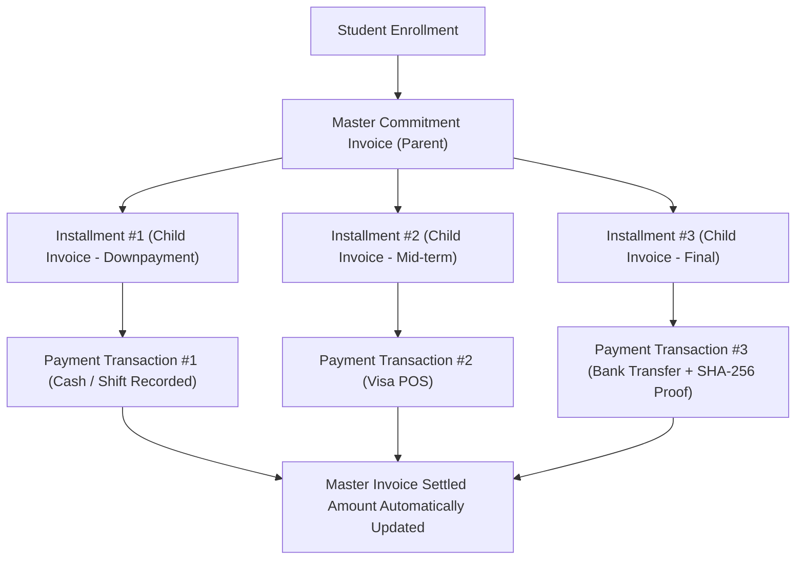

# Business Domain, Operations & Cascading State Engine
**Document ID:** `PLN-01-DOMAIN-OPERATIONS`  
**System Codename:** `Project Apex` (Temporary Working Title)  
**Status:** Canonical Reference Blueprint  
**Language:** English  

---

## 1. The Core ERP Domain Entities & Hierarchies

The system operates on an explicit 5-tier organizational hierarchy:
$$\text{Platform (SaaS Root)} \longrightarrow \text{Tenant (Academy)} \longrightarrow \text{Branch} \longrightarrow \text{Facility / Classroom} \longrightarrow \text{Course Offering (Group)}$$

### 1.1 Course Templates vs. Course Offerings (Groups)
* **`CourseTemplate` (Academic Blueprint):**
  - Defines the curriculum syllabus, targeted age brackets, default session duration in hours (e.g., 2.0 hrs), total recommended sessions, and base pricing.
  - Acts as an immutable master catalog owned at the Tenant level.
* **`CourseOffering` (Active Scheduled Cohort / Group):**
  - Instantiated at a specific Branch.
  - Linked to exactly **one Primary Instructor** (`PrimaryInstructorId`).
  - Constrained by a strict physical schedule:
    - **Date Window:** `StartDate` to `EndDate`.
    - **Weekly Pattern:** Selected days (e.g., `["Monday", "Thursday"]`).
    - **Daily Slot:** `StartTime` to `EndTime` (e.g., `16:00` to `18:00`).
    - **Room Allocation:** Assigned to a specific `ClassroomId`.
  - **Seat Quotas:** `MaxCapacity` and `WaitlistCapacity`. When active enrollments reach `MaxCapacity`, the registration engine prevents further standard admissions and routes new students to the Waitlist queue.

---

## 2. Invoicing, Master Contracts & Installment Architecture

The financial domain separates the overarching contractual obligation from individual collection milestones.

### 2.1 Master Contract Invoice (`MasterInvoice`)
* Generated at the moment of student enrollment.
* Tracks:
  - `GrossAmount`: Full curriculum tuition plus materials/kit fees.
  - `DiscountAmount`: Authorized promotional discounts or scholarship reductions.
  - `NetAmount`: Final binding obligation.
  - `SettledAmount`: Aggregated total of all verified payments across all child invoices.
  - `RemainingBalance`: $\text{NetAmount} - \text{SettledAmount}$.
  - `Status`: `ISSUED` $\rightarrow$ `PARTIALLY_SETTLED` $\rightarrow$ `FULLY_SETTLED` $\rightarrow$ `VOIDED`.

### 2.2 Installment Invoices (`InstallmentInvoice`)
* Each installment is a legally distinct, printable financial instrument with a unique `InvoiceNumber`.
* Carries its own explicit `DueDate`, `Amount`, and penalty/grace parameters.
* **Cascading Settle Rule:** Whenever a payment transaction is verified against an `InstallmentInvoice`:
  1. The `InstallmentInvoice` status transitions (`PENDING` $\rightarrow$ `PAID`).
  2. The linked `MasterInvoice.SettledAmount` is atomically incremented by the transaction amount.
  3. If `MasterInvoice.SettledAmount == MasterInvoice.NetAmount`, the Master Invoice state automatically transitions to `FULLY_SETTLED`.

---

## 3. Universal Staff Compensation & Automated Payroll Engine

Every academy configures the compensation model per staff member or instructor within their contract terms. The ERP supports four distinct calculation strategies:

| Strategy Code | Compensation Basis | Calculation Formula | Trigger / Accumulator |
|---|---|---|---|
| `HOURLY_RATE` | Pay per actual instructional hour | $\sum (\text{Completed Session Duration in Hours} \times \text{Agreed Hourly Rate})$ | Incremented upon session marked `COMPLETED` |
| `FIXED_SALARY` | Flat monthly guaranteed salary | $\text{Base Salary} - \text{Absence Deductions} + \text{Overtime/Bonus}$ | Evaluated at monthly payroll closing date |
| `PERCENTAGE_OF_REVENUE` | Commission on student cohort collections | $\sum (\text{Verified Student Installments Paid in Assigned Groups}) \times \text{Commission } \%$ | Triggered upon payment verification |
| `PER_COURSE_FLAT` | Lump-sum contractual amount for full course | $\text{Agreed Course Fee} \times (\text{Completed Sessions} / \text{Total Sessions})$ or upon Course Completion | Accrued per session or paid upon cohort close |

### 3.1 Payroll Reconciliation Cycles
1. **Monthly Settlement Cycle (Standard ERP Mode):**
   - On the 1st of each calendar month, the system generates a draft payroll run (`PayrollRun`) for all staff.
   - For `HOURLY_RATE` instructors, it sums all sessions completed in the prior month where the instructor was the designated active educator.
2. **Course-End Settlement Cycle (Milestone Mode):**
   - Certain academies operate on a project basis. When a `CourseOffering` is marked `COMPLETED`, the system triggers an automatic settlement proposal for the primary instructor.

---

## 4. Single Primary Instructor & Session Substitution Mechanism

1. **Strict Single Ownership:** Every `CourseOffering` has one designated primary instructor. This prevents ambiguity in instructional accountability and curriculum continuity.
2. **The Substitution Request Workflow:**
   * When the primary instructor cannot attend session $K$:
     - A `SessionSubstitutionProposal` is submitted (by instructor or secretary).
     - Reason and proposed substitute instructor are specified.
     - An `ApprovalRequest` is created for the Branch Manager or Head Instructor.
   * **Cascading Approval Effects:**
     - The `AcademySession.InstructorId` is updated to the substitute for session $K$ only.
     - The primary instructor's profile remains linked as the historical group owner.
     - **Payroll Routing:** The hours/fee for session $K$ are credited to the **substitute instructor's payroll ledger**, while the primary instructor's ledger receives zero credit for that session.

---

## 5. Front-Desk Cash Shifts & Reconciliation (Inflow & Outflow)

Rather than enforcing arbitrary limits, the platform operates a real-time **Cash Drawer Ledger**:

$$\text{Expected Drawer Balance} = \text{Opening Balance} + \sum \text{Cash Inflows (Receipts)} - \sum \text{Cash Outflows (Petty Cash)}$$

### 5.1 Shift Lifecycle & Blind Reconciliation
1. **Open Shift:** Receptionist enters starting cash in drawer (`OpeningFloat`).
2. **Active Operations:**
   - Cash collections from installments automatically record a `CashTransaction` tied to the active shift.
   - Petty cash disbursements approved by the manager record an outflow against the shift.
3. **Blind Cash Drop (Close Shift):**
   - At shift handover, the receptionist physically counts the drawer and enters the `CountedCashAmount` without seeing the expected ledger figure.
4. **Discrepancy Calculation & Audit:**
   - $\text{Discrepancy} = \text{CountedCashAmount} - \text{Expected Drawer Balance}$.
   - The discrepancy is logged in the permanent audit ledger.
   - The Branch Manager and Accountant review and sign off on the handover.

---

## 6. Comprehensive Operations Cascading Matrix

The table below illustrates exactly how primary user actions propagate across secondary and tertiary modules:

| Initiating Action | Triggered By | Immediate Domain Updates | Secondary Cascading Effects | Tertiary Notifications / Accounting |
|---|---|---|---|---|
| **Register & Enroll Student** | Secretary (`R05`) | New `Student` record created; New `StudentEnrollment` attached. | `MasterInvoice` generated with child `InstallmentInvoice` records; Cohort occupancy count $+1$. | Welcome SMS/WhatsApp dispatched; Initial installment marked in front-desk due collection queue. |
| **Complete Session & Attendance** | Instructor (`R04`) | `AcademySession` state $\rightarrow$ `COMPLETED`; Attendance records frozen. | `SessionEvaluation` drafts unlocked for instructor input; Instructor hourly accumulator credited. | Head Instructor notified of submitted evaluations; Student attendance percentage updated. |
| **Publish Academic Evaluation** | Head Instructor (`R03`) | `SessionEvaluation` status $\rightarrow$ `PUBLISHED`. | Academic radar chart and student progress metrics refreshed. | In-App push notification sent to Parent (`R08`) and Student (`R09`) portals. |
| **Record Cash Installment** | Secretary (`R05`) | `PaymentTransaction` created; `InstallmentInvoice` $\rightarrow$ `PAID`. | Linked `MasterInvoice.SettledAmount` incremented; Current shift `CashInflow` updated. | Receipt PDF generated with tamper-evident QR code; Guardian balance cleared. |
| **Approve Substitute Instructor** | Branch Manager (`R02`) | `SessionSubstitutionProposal` $\rightarrow$ `APPROVED`; Session instructor assigned. | Session calendar updated with substitute badge. | Substitute instructor receives calendar notification; Payroll ledger credit transferred. |
| **Approve Subscription Freeze** | Branch Manager (`R02`) | `SubscriptionFreezeRequest` $\rightarrow$ `APPROVED`; Enrollment status $\rightarrow$ `FROZEN`. | Student removed from active session attendance sheets; Installment due dates extended by freeze duration. | Group seat made available for temporary sub; Guardian notified of approved freeze window. |

