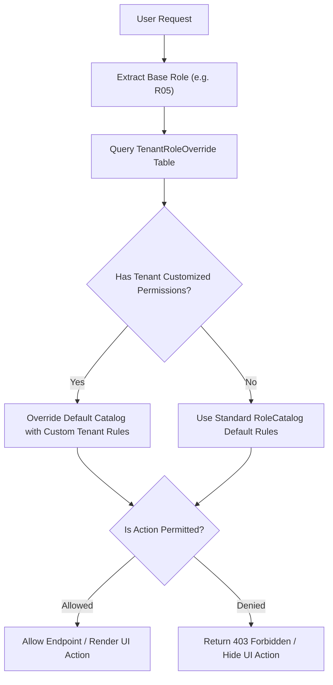

# Product Owner Specification & Role UX Framework
**Document ID:** `PLN-02-PO-ROLES-UX`  
**System Codename:** `Project Apex` (Temporary Working Title)  
**Status:** Canonical Reference Blueprint  
**Language:** English  

---

## 1. Product Philosophy: Radical Role Simplification

The core objective of `Project Apex` is to eliminate the friction and cognitive clutter common to traditional ERP systems. Every staff member and consumer interacts with a tailored, role-specific "cockpit" designed around 3 design rules:
1. **Rule of Immediate Actionability:** The topmost viewport of any screen displays items requiring immediate attention today (e.g., sessions starting in 15 mins, unverified bank receipts, pending freeze requests).
2. **Rule of Progressive Disclosure:** Complex forms are broken into bite-sized steppers with sensible defaults and inline validation.
3. **Rule of Role Isolation:** A user only sees what is relevant to their job. An instructor never sees financial numbers, and a receptionist never sees administrative payroll spreadsheets.

---

## 2. Detailed Role Specifications & Dashboard Workspaces

### R00: Platform Super-Administrator
* **Target Audience:** SaaS infrastructure and platform engineering team.
* **Core Mission:** Monitor tenant health, orchestrate new academy onboarding, and enforce plan quotas.
* **Cockpit Layout (`/platform-console`):**
  - **Tenant Health Matrix:** Real-time metrics showing active academies, active users, storage utilization, and database connection pool statuses.
  - **Academy Bootstrap Wizard:** One-click provisioning of new academies with database schema isolation, default branch initialization, and owner credentials setup.
  - **Plan & Quota Enforcement:** Dynamically adjust student limits, branch limits, and storage caps per subscription tier.
  - **Global Audit & Support Desk:** Cross-academy support ticket handling with impersonation audit logging.

### R01: Academy Owner (Executive Cockpit)
* **Target Audience:** Academy founders, CEOs, and executive boards.
* **Core Mission:** High-level strategic oversight, multi-branch profitability, and system-wide governance.
* **Cockpit Layout (`/executive-dashboard`):**
  - **Multi-Branch P&L & Cash Flow:** Consolidated revenue vs. expenses, aging overdue receivables, and forecasted cash flow.
  - **Branch Performance Benchmarking:** Side-by-side comparison of student retention, cohort utilization %, and lead conversion velocity across branches.
  - **Strategic Approval Queue:** High-value expense approvals, credit note approvals, and exception authorizations.
  - **Dynamic Permissions Control Center (`/academy-roles`):** Visual matrix allowing the Owner to toggle any permission, menu item, or button for any role across the academy.

### R02: Branch Operations Manager
* **Target Audience:** General managers responsible for a specific physical branch.
* **Core Mission:** Daily operational rhythm, physical facility allocation, and resolving operational exceptions.
* **Cockpit Layout (`/` Home):**
  - **Today's Operational Pulse:** Real-time summary of today's scheduled sessions, room occupancies, and instructor check-in statuses.
  - **Fast Substitution Dispatcher:** Instant alert for missing or late instructors with one-click assignment of qualified branch substitutes.
  - **Enrollment & Transfer Desk:** Approve student cohort transfers, schedule changes, and branch-level student freezes.
  - **Facility Management:** Classroom resource audits and equipment kit assignments.

### R03: Head Instructor / Academic Quality Supervisor
* **Target Audience:** Educational leaders, subject-matter experts, and pedagogical supervisors.
* **Core Mission:** Curriculum adherence, instructor mentoring, and academic quality assurance.
* **Cockpit Layout (`/head-instructors`):**
  - **Evaluation Review Queue:** Draft evaluations submitted by instructors awaiting quality audit before publishing to parents.
  - **Instructor Performance Radar:** Metrics on evaluation turnaround times, student attendance rates per cohort, and student feedback scores.
  - **Cohort Progress Tracking:** Syllabus completion milestones across all active offerings under supervision.

### R04: Instructor / Classroom Educator
* **Target Audience:** Teachers, trainers, and laboratory instructors.
* **Core Mission:** Ultra-fast session execution, rapid attendance taking, and student skill evaluations.
* **Cockpit Layout (`/instructor-desk`):**
  - **Next Up Session Card:** Large, tactile card displaying the immediate next session, room number, kit list, and student count.
  - **One-Tap Attendance Sheet:** Rapid attendance toggling (Present / Absent / Late / Excused) with bulk "Mark All Present" shortcut.
  - **Skill Evaluation Composer:** Simple rating rubrics (1-5 stars or rubric chips) with predefined educational feedback templates and gamification badge awards.
  - **Leave & Substitution Request Button:** Simple single-click form to request a substitute for an upcoming session with reason entry.

### R05: Reception & Front-Desk Secretary
* **Target Audience:** Front-desk receptionists, customer care coordinators, and admissions staff.
* **Core Mission:** Lead qualification, walk-in inquiries, fast student enrollment, and cash drawer management.
* **Cockpit Layout (`/secretary-desk`):**
  - **Active Shift Drawer Status:** Prominent sticky badge showing current shift status, time opened, and total cash collected today.
  - **Leads & Inquiries Kanban:** Visual pipeline (New Lead $\rightarrow$ Contacted $\rightarrow$ Trial Booked $\rightarrow$ Converted $\rightarrow$ Lost) with quick call/WhatsApp shortcuts.
  - **Express Registration Stepper:** 3-step rapid enrollment modal (Student Info $\rightarrow$ Choose Cohort $\rightarrow$ Collect Downpayment & Print Receipt).
  - **Today's Collections & Freezes:** Queue of installments due today and guardian freeze/compensation requests.

### R06: Financial Accountant
* **Target Audience:** Branch and academy financial accountants.
* **Core Mission:** Billing accuracy, payment verification, cash drawer reconciliations, and payroll generation.
* **Cockpit Layout (`/finance-desk`):**
  - **Treasury & Aging Receivables:** Overdue installments categorized by 30/60/90 days aging buckets.
  - **Payment Verification Queue:** Bank transfers and online payments awaiting document verification against uploaded proof slips.
  - **Shift Handover Audit:** Verify receptionist cash drawer counts, flag discrepancies, and close daily branch registers.
  - **Monthly Payroll Wizard:** One-click payroll calculation aggregating hours, fixed salaries, commissions, and deductions into approval-ready payroll sheets.

### R07: Marketing & Growth Coordinator
* **Target Audience:** Social media managers, acquisition marketers, and event coordinators.
* **Core Mission:** Inbound lead generation, campaign attribution, and marketing content calendar.
* **Cockpit Layout (`/marketing-desk`):**
  - **Campaign ROI Tracker:** Lead acquisition cost (CAC) and conversion rate per channel (Meta, TikTok, Referral, Street Campaign).
  - **Content Calendar & Queue:** Scheduled content releases, event milestones, and academy promotional workshops.

### R08: Guardian / Parent (Consumer Portal)
* **Target Audience:** Parents and legal guardians.
* **Core Mission:** Mobile-first peace of mind, tracking student progress, and frictionless payment.
* **Cockpit Layout (`/family-portal`):**
  - **Children Switcher:** Seamless tabbed switcher to view multiple enrolled children from a single login.
  - **Today's Attendance & Timetable:** Clean visual schedule of upcoming classes and bus pick-up notifications.
  - **Progress & Badges Showcase:** Published academic evaluations, skill radar charts, and badges won.
  - **Installments & One-Click Pay:** Clear breakdown of upcoming and paid installments, with digital receipt download and direct bank transfer slip upload.

### R09: Student (Learner Portal)
* **Target Audience:** Enrolled students and young learners.
* **Core Mission:** Gamified learning journey, schedule tracking, and competition participation.
* **Cockpit Layout (`/student-portal`):**
  - **My Classes & Projects:** Timetable, project materials, and downloadable worksheets.
  - **Hall of Fame & Badges:** Gamified badges collected, competition awards, and certificate repository.

---

## 3. Dynamic Administrative Governance (The RBAC Override Engine)

To fulfill the architectural requirement of **"The Admin decides what each role sees and can do"**, the system features a runtime dynamic permission evaluator:

### Visual Admin Matrix Capabilities:
1. **Module Level:** Completely hide or show entire workspaces (e.g., enable the Marketing Desk for Branch B, disable it for Branch C).
2. **Sub-View / Tab Level:** Allow Secretary to see the Registration tab, but revoke access to the Freezes or Shifts tab.
3. **Button / Action Level:** Allow Accountant to create an invoice, but disable the "Void Invoice" button unless approved by Owner.

