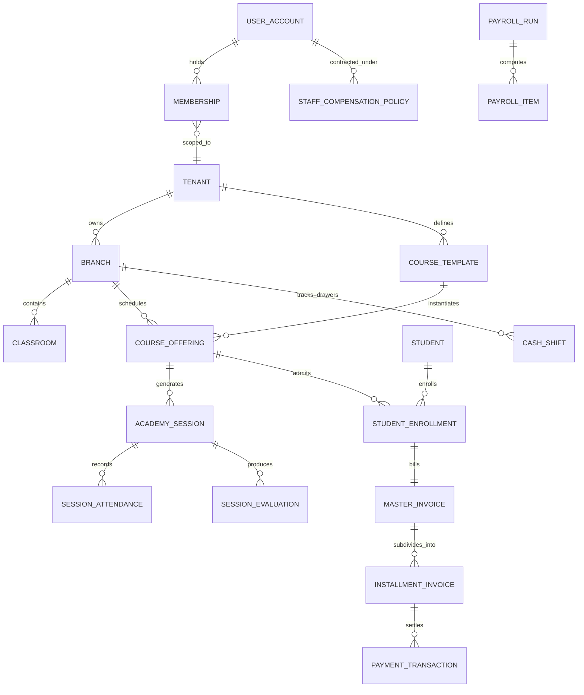

# Entities, Relations & Data Dictionary
**Document ID:** `PLN-05-DATA-DICTIONARY`  
**System Codename:** `Project Apex` (Temporary Working Title)  
**Status:** Canonical Reference Blueprint  
**Language:** English  

---

## 1. Domain Entity Relationship Diagram

---

## 2. Comprehensive Data Dictionary by Module

### 2.1 Multi-Tenancy & Identity Cluster

#### `Tenants`
Represents an individual academy organization subscribed to the platform.
* `Id` (`Guid`, PK): Unique academy tenant identifier.
* `Name` (`varchar(160)`): Legal or commercial name of the academy.
* `Slug` (`varchar(80)`, Unique Index): Subdomain identifier for tenant routing.
* `PlanCode` (`varchar(32)`): Subscription tier (`TRIAL`, `STARTER`, `GROWTH`, `ENTERPRISE`).
* `Status` (`varchar(32)`): Account standing (`ACTIVE`, `SUSPENDED`, `DELINQUENT`).
* `FeatureOverridesJson` (`jsonb`): Custom feature toggles specific to this tenant.
* `CreatedAt` (`timestamptz`): Record creation timestamp.

#### `Branches`
Physical operating locations under an academy.
* `Id` (`Guid`, PK): Branch identifier.
* `TenantId` (`Guid`, FK $\rightarrow$ `Tenants.Id`, Cascade): Parent tenant.
* `Code` (`varchar(40)`): Short branch code (e.g., `BR-MAIN`, `BR-EAST`). Unique per tenant.
* `Name` (`varchar(160)`): Branch display name.
* `Address` (`varchar(255)`): Physical street address and location.
* `Phone` (`varchar(40)`): Front-desk primary contact number.

#### `UserAccounts`
Central authentication identity.
* `Id` (`Guid`, PK): User identifier.
* `Email` (`varchar(320)`, Unique, Nullable): Staff email address.
* `Phone` (`varchar(32)`, Index): Mobile phone number (required for consumer accounts).
* `AccountType` (`varchar(16)`): `staff` or `consumer`.
* `PasswordHash` (`varchar(256)`): BCrypt hashed password with salt.
* `Status` (`varchar(32)`): `ACTIVE`, `LOCKED`, `INVITED`.
* `FailedPasswordAttempts` (`int`): Security brute-force counter.

#### `Memberships`
Binds a staff `UserAccount` to a specific `Tenant` and `Branch` with a role.
* `Id` (`Guid`, PK): Membership identifier.
* `UserAccountId` (`Guid`, FK $\rightarrow$ `UserAccounts.Id`, Cascade).
* `TenantId` (`Guid`, FK $\rightarrow$ `Tenants.Id`, Cascade).
* `BranchId` (`Guid`, Nullable, FK $\rightarrow$ `Branches.Id`, Restrict): Nullable for `R01_ACADEMY_OWNER`.
* `RoleCode` (`varchar(32)`): `R01_ACADEMY_OWNER` down to `R07_MARKETING`.
* `ScopeLevel` (`varchar(32)`): `tenant`, `branch`, or `assigned`.

#### `TenantRoleOverrides`
Stores dynamic RBAC permission overrides set by the Academy Owner.
* `Id` (`Guid`, PK): Record identifier.
* `TenantId` (`Guid`, FK $\rightarrow$ `Tenants.Id`, Cascade).
* `RoleCode` (`varchar(32)`): Role being modified.
* `PermissionsJson` (`jsonb`): Array of granted and denied permission keys.

---

### 2.2 Academics & Offerings Cluster

#### `CourseTemplates`
Master syllabus catalog.
* `Id` (`Guid`, PK).
* `TenantId` (`Guid`, FK $\rightarrow$ `Tenants.Id`).
* `Name` (`varchar(160)`): Course title (e.g., "Robotics Level 1").
* `SessionDurationHours` (`decimal(6,2)`): Default duration (e.g., `2.00`).
* `TotalSessionsCount` (`int`): Number of scheduled classes in the syllabus.
* `BaseTuitionPrice` (`decimal(12,2)`): Default standard tuition fee.

#### `CourseOfferings` (Active Cohorts / Groups)
An actual scheduled delivery of a course.
* `Id` (`Guid`, PK).
* `TenantId` (`Guid`, FK $\rightarrow$ `Tenants.Id`).
* `BranchId` (`Guid`, FK $\rightarrow$ `Branches.Id`).
* `CourseTemplateId` (`Guid`, FK $\rightarrow$ `CourseTemplates.Id`).
* `PrimaryInstructorId` (`Guid`, FK $\rightarrow$ `UserAccounts.Id`): Sole designated group leader.
* `ClassroomId` (`Guid`, FK $\rightarrow$ `Classrooms.Id`): Allocated physical room.
* `WeeklyScheduleJson` (`jsonb`): `{"days": [1, 4], "startTime": "16:00", "endTime": "18:00"}`.
* `StartDate` (`date`): First day of the group.
* `EndDate` (`date`): Scheduled graduation day.
* `MaxCapacity` (`int`): Maximum students (e.g., 12).
* `Status` (`varchar(32)`): `SCHEDULED`, `RUNNING`, `COMPLETED`, `ARCHIVED`.

---

### 2.3 Financial Cluster: Invoicing, Installments & Cash

#### `MasterInvoices`
The overarching tuition contract for an enrollment.
* `Id` (`Guid`, PK).
* `TenantId` (`Guid`, FK $\rightarrow$ `Tenants.Id`).
* `BranchId` (`Guid`, FK $\rightarrow$ `Branches.Id`).
* `EnrollmentId` (`Guid`, FK $\rightarrow$ `StudentEnrollments.Id`).
* `StudentId` (`Guid`, FK $\rightarrow$ `Students.Id`).
* `ContractNumber` (`varchar(48)`, Unique): Human-readable master contract ID.
* `GrossAmount` (`decimal(12,2)`): Initial total before discount.
* `DiscountAmount` (`decimal(12,2)`): Approved deductions.
* `NetAmount` (`decimal(12,2)`): Net contractual commitment.
* `SettledAmount` (`decimal(12,2)`): Running sum of verified payments.
* `Status` (`varchar(24)`): `ISSUED`, `PARTIALLY_SETTLED`, `FULLY_SETTLED`, `VOIDED`.

#### `InstallmentInvoices`
Distinct installment collection instruments.
* `Id` (`Guid`, PK).
* `MasterInvoiceId` (`Guid`, FK $\rightarrow$ `MasterInvoices.Id`, Cascade).
* `InvoiceNumber` (`varchar(48)`, Unique): Sequential bill number (e.g., `INV-2026-00452`).
* `InstallmentNumber` (`int`): Sequence index (1, 2, 3...).
* `DueDate` (`date`): Mandatory payment deadline.
* `Amount` (`decimal(12,2)`): Installment amount due.
* `PaidAmount` (`decimal(12,2)`): Amount settled to date.
* `Status` (`varchar(24)`): `PENDING`, `PARTIAL`, `PAID`, `OVERDUE`.

#### `PaymentTransactions`
Verified cash or digital receipts.
* `Id` (`Guid`, PK).
* `InstallmentInvoiceId` (`Guid`, FK $\rightarrow$ `InstallmentInvoices.Id`, Restrict).
* `TenantId` (`Guid`, FK $\rightarrow$ `Tenants.Id`).
* `BranchId` (`Guid`, FK $\rightarrow$ `Branches.Id`).
* `CashShiftId` (`Guid`, Nullable, FK $\rightarrow$ `CashShifts.Id`): Populated if paid in cash.
* `Amount` (`decimal(12,2)`): Amount paid.
* `Method` (`varchar(24)`): `CASH`, `CREDIT_CARD`, `BANK_TRANSFER`, `INSTAPAY`.
* `ReceivedOn` (`timestamptz`): Date and time of payment.
* `IdempotencyKey` (`varchar(128)`, Unique): Prevents duplicate charge processing.

#### `CashShifts`
Daily receptionist cash register drawers.
* `Id` (`Guid`, PK).
* `BranchId` (`Guid`, FK $\rightarrow$ `Branches.Id`).
* `SecretaryUserId` (`Guid`, FK $\rightarrow$ `UserAccounts.Id`).
* `OpenedAt` (`timestamptz`): Shift open timestamp.
* `ClosedAt` (`timestamptz`, Nullable): Shift close timestamp.
* `OpeningFloat` (`decimal(12,2)`): Starting cash in drawer.
* `TotalCashIn` (`decimal(12,2)`): Sum of cash payments received.
* `TotalCashOut` (`decimal(12,2)`): Sum of cash expenses disbursed.
* `CountedCashAmount` (`decimal(12,2)`, Nullable): Physical blind count entered by staff.
* `Discrepancy` (`decimal(12,2)`, Nullable): `Counted - (Opening + In - Out)`.
* `Status` (`varchar(24)`): `OPEN`, `CLOSED`, `AUDITED_BY_FINANCE`.

---

### 2.4 Staff Compensation & Payroll Cluster

#### `StaffCompensationPolicies`
Defines how each staff member or instructor is paid.
* `Id` (`Guid`, PK).
* `TenantId` (`Guid`, FK $\rightarrow$ `Tenants.Id`).
* `UserAccountId` (`Guid`, FK $\rightarrow$ `UserAccounts.Id`).
* `Model` (`varchar(32)`): `HOURLY_RATE`, `FIXED_SALARY`, `PERCENTAGE_OF_REVENUE`, `PER_COURSE_FLAT`.
* `RateAmount` (`decimal(12,2)`): Dollar/Pound value (e.g., $25/hr or $1500/month).
* `CommissionPercent` (`decimal(5,2)`, Nullable): Percentage if revenue model.
* `SettlementFrequency` (`varchar(24)`): `MONTHLY`, `COURSE_END`.

#### `PayrollRuns`
A specific monthly or milestone payroll settlement.
* `Id` (`Guid`, PK).
* `TenantId` (`Guid`, FK $\rightarrow$ `Tenants.Id`).
* `BranchId` (`Guid`, FK $\rightarrow$ `Branches.Id`).
* `PeriodStartDate` (`date`).
* `PeriodEndDate` (`date`).
* `TotalGrossPayout` (`decimal(14,2)`).
* `Status` (`varchar(24)`): `DRAFT`, `PENDING_OWNER_APPROVAL`, `APPROVED`, `DISBURSED`.
* `ApprovedByUserId` (`Guid`, Nullable, FK $\rightarrow$ `UserAccounts.Id`).

#### `PayrollItems`
Individual line item for a staff member in a payroll run.
* `Id` (`Guid`, PK).
* `PayrollRunId` (`Guid`, FK $\rightarrow$ `PayrollRuns.Id`, Cascade).
* `StaffUserId` (`Guid`, FK $\rightarrow$ `UserAccounts.Id`).
* `BaseCalculatedAmount` (`decimal(12,2)`): Computed from completed hours/salary/percentage.
* `BonusAmount` (`decimal(12,2)`): Additional allowances or incentives.
* `DeductionAmount` (`decimal(12,2)`): Absence or penalty deductions.
* `NetPayoutAmount` (`decimal(12,2)`): `Base + Bonus - Deduction`.
* `AuditSummaryJson` (`jsonb`): Array of session IDs and formulas used in computation.

