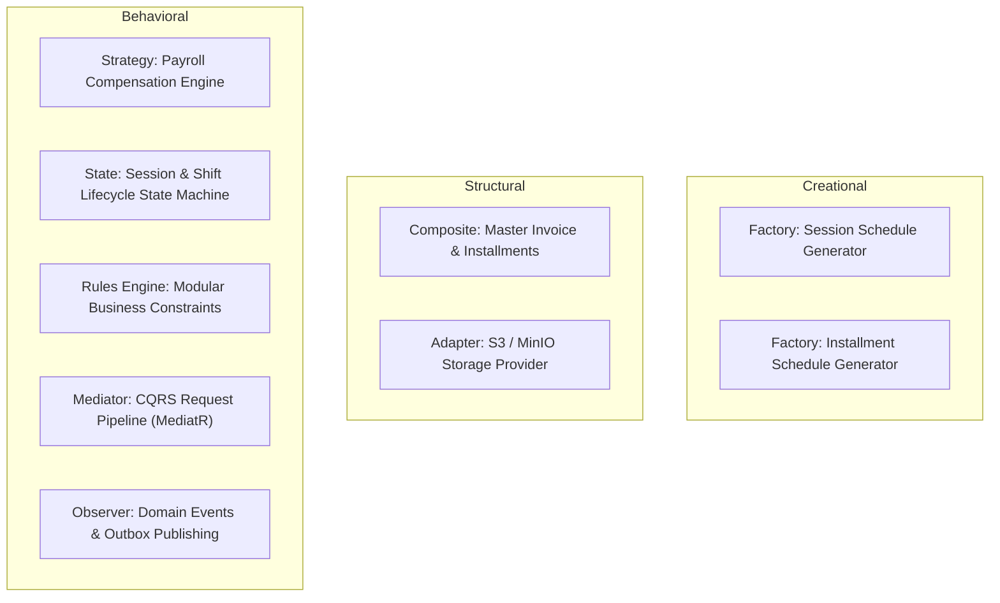

# Design Patterns & Rules Engine Architecture
**Document ID:** `PLN-06-PATTERNS-RULES`  
**System Codename:** `Project Apex` (Temporary Working Title)  
**Status:** Canonical Reference Blueprint  
**Language:** English  

---

## 1. Catalog of Enterprise Design Patterns

The architecture avoids ad-hoc coding in favor of proven enterprise design patterns across both Backend and Frontend:



---

## 2. In-Depth Pattern Implementations

### 2.1 The Rules Engine Pattern (Centralized Business Invariants)
Rather than scattering `if-else` business checks throughout application services, business rules are modeled as atomic, reusable, and composable rule specifications.

#### Interface Contract:
```csharp
public interface IBusinessRule<in TContext>
{
    string RuleCode { get; }
    string ErrorMessage { get; }
    Task<RuleEvaluationResult> EvaluateAsync(TContext context, CancellationToken ct = default);
}

public sealed record RuleEvaluationResult(bool IsPassed, string? FailureReason = null)
{
    public static RuleEvaluationResult Pass() => new(true);
    public static RuleEvaluationResult Fail(string reason) => new(false, reason);
}
```

#### Real-World Rule Implementations:
1. **`SubscriptionFreezeEligibilityRule`:**
   - *Predicate:* Student must have zero overdue installments + total frozen days this quarter $\le 14$ days + no active freeze currently running.
2. **`ClassroomCapacityRule`:**
   - *Predicate:* Active cohort enrolled student count cannot exceed `Classroom.MaxCapacity`.
3. **`ScheduleConflictRule`:**
   - *Predicate:* An instructor cannot have two overlapping sessions within $t_{\text{start}} - 15\text{ mins}$ to $t_{\text{end}} + 15\text{ mins}$.

---

### 2.2 The Strategy Pattern: Universal Payroll Engine
Staff compensation calculation is decoupled from the payroll orchestration service using the Strategy Pattern.

```csharp
public interface ICompensationStrategy
{
    CompensationModel Model { get; }
    Task<decimal> CalculateBaseCompensationAsync(
        StaffCompensationPolicy policy,
        DateOnly periodStart,
        DateOnly periodEnd,
        CancellationToken ct = default);
}

// Strategy 1: Hourly Rate
public sealed class HourlyCompensationStrategy(ISessionRepository sessions) : ICompensationStrategy
{
    public CompensationModel Model => CompensationModel.HourlyRate;

    public async Task<decimal> CalculateBaseCompensationAsync(StaffCompensationPolicy policy, DateOnly periodStart, DateOnly periodEnd, CancellationToken ct)
    {
        var completedHours = await sessions.GetCompletedHoursForInstructorAsync(policy.UserAccountId, periodStart, periodEnd, ct);
        return completedHours * policy.RateAmount;
    }
}

// Strategy 2: Revenue Percentage
public sealed class RevenuePercentageCompensationStrategy(IFinanceRepository finance) : ICompensationStrategy
{
    public CompensationModel Model => CompensationModel.PercentageOfRevenue;

    public async Task<decimal> CalculateBaseCompensationAsync(StaffCompensationPolicy policy, DateOnly periodStart, DateOnly periodEnd, CancellationToken ct)
    {
        var collectedTuition = await finance.GetVerifiedCollectionsForInstructorCohortsAsync(policy.UserAccountId, periodStart, periodEnd, ct);
        return collectedTuition * ((policy.CommissionPercent ?? 0m) / 100m);
    }
}
```

---

### 2.3 The State Machine Pattern (Session & Shift Transitions)
Critical entities govern their state transitions explicitly. Arbitrary direct assignment of `entity.Status = "X"` is strictly prohibited.

#### Example: `AcademySession` State Transitions
```csharp
public sealed class AcademySession : AggregateRoot
{
    public SessionStatus Status { get; private set; } = SessionStatus.Scheduled;

    public Result StartSession(DateTime actualStartTime)
    {
        if (Status != SessionStatus.Scheduled)
            return Result.Failure("Only SCHEDULED sessions can be started.");

        Status = SessionStatus.InProgress;
        ActualStartTime = actualStartTime;
        AddDomainEvent(new SessionStartedDomainEvent(Id, BranchId, InstructorId));
        return Result.Success();
    }

    public Result CompleteSession(DateTime actualEndTime, int presentCount)
    {
        if (Status != SessionStatus.InProgress)
            return Result.Failure("Only IN_PROGRESS sessions can be completed.");

        Status = SessionStatus.Completed;
        ActualEndTime = actualEndTime;
        AddDomainEvent(new SessionCompletedDomainEvent(Id, BranchId, InstructorId, actualEndTime));
        return Result.Success();
    }
}
```

---

### 2.4 The Composite Pattern: Master & Installment Invoices
The financial module treats individual installment invoices as leaf nodes and the master tuition contract as the aggregate root:

$$\text{MasterInvoice.SettledAmount} = \sum_{k=1}^{n} \text{InstallmentInvoice}_k.\text{PaidAmount}$$

* Adding an adjustment line item or scholarship discount updates the root, which recalculates downstream installment quotas via the `InstallmentScheduleGeneratorFactory`.

