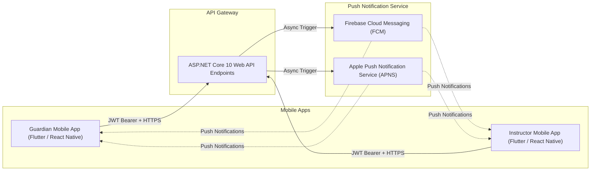

# Mobile API Contract & Cross-Platform Readiness
**Document ID:** `PLN-08-MOBILE-READINESS`  
**System Codename:** `Project Apex` (Temporary Working Title)  
**Status:** Canonical Reference Blueprint  
**Language:** English  

---

## 1. Mobile-First & API-First Architectural Strategy

The backend is engineered from day one as an omni-channel API. Any endpoint accessible by the Angular web application can be consumed with zero modification by native or cross-platform mobile frameworks (Flutter, React Native, iOS Swift, Android Kotlin).



---

## 2. Key Mobile Operational Workflows

### 2.1 The Instructor Offline Attendance Engine
Instructors often work in areas with intermittent Wi-Fi (e.g., sports halls, robotics labs). The mobile API supports an offline-first sync pattern:

1. **Session Pre-fetch:** When connected, the app fetches today's sessions and rosters via `GET /api/v1/mobile/instructor/today-bundle`.
2. **Local Cache:** Attendance is marked locally in SQLite / Hive on the device.
3. **Bulk Sync:** Once internet connectivity is restored, the app dispatches:
   - `POST /api/v1/mobile/instructor/sync-attendance`
   - *Payload:* Array of `{ sessionId, studentId, status, timestamp, clientMutationId }`.
   - The backend validates the `clientMutationId` to guarantee idempotency and avoid duplicate submissions.

### 2.2 Guardian Mobile Experience (Parent App)
Designed for one-handed operation on mobile devices:
* **Child Selector Bottom Sheet:** Quick tap to toggle between children.
* **Instant Digital Receipts:** One-tap download of installment tax receipts.
* **Camera Integration:** Snap and upload bank transfer proof receipts directly using the mobile camera, with immediate client-side image compression before upload to S3.
* **Biometric Auth:** Secure login using FaceID / Fingerprint unlocking stored refresh tokens in iOS Keychain / Android Keystore.

---

## 3. Push Notifications Architecture

To replace fragile SMS costs, transactional alerts are dispatched via Firebase Cloud Messaging (FCM):

### 3.1 Device Registration Endpoint
* `POST /api/v1/mobile/devices/register`
* *Request Body:*
  ```json
  {
    "deviceToken": "fcm_token_string_here",
    "platform": "ANDROID", // or "IOS"
    "deviceModel": "Samsung Galaxy S24",
    "appVersion": "1.0.0"
  }
  ```

### 3.2 Automated Transactional Push Triggers
| Event Trigger | Target User | Push Notification Content |
|---|---|---|
| **Session Completed** | Parent (`R08`) | "Omar completed today's Robotics session! Tap to see the published progress notes." |
| **New Evaluation Published** | Parent (`R08`) & Student (`R09`) | "Congratulations! An academic badge 'Creative Problem Solver' was awarded to Sara." |
| **Installment Due Reminder** | Parent (`R08`) | "Reminder: Installment #2 for Course Robotics Level 1 is due in 3 days." |
| **Substitute Request Approved** | Instructor (`R04`) | "Your session on Tuesday at 4:00 PM has been assigned to substitute Coach Ahmed." |

